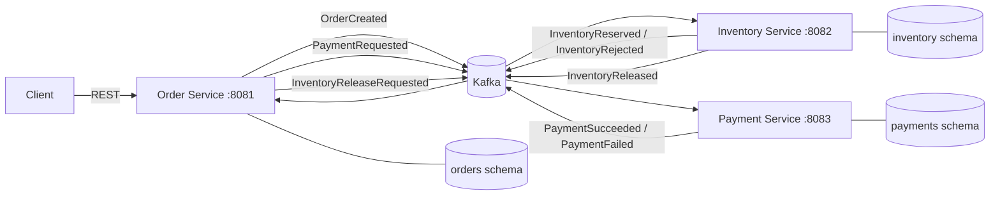

# FlowOps Enterprise

A reproducible, event-driven Java MVP: create an order, reserve stock, simulate payment,
and compensate rejected payments. **v0.1.0 is prepared for review, not published.**
No real payments, card data, authentication or production infrastructure are included.

## Architecture



Three independent Spring Boot services own separate PostgreSQL roles, schemas and Flyway
migrations. Order orchestrates the saga; Inventory owns products, stock and reservations;
Payment simulates one durable attempt per order. Shared contracts contain transport DTOs
and JSON schemas only. Kafka delivery is **at least once**: transactional outboxes, inboxes,
logical uniqueness and row locks protect business effects. There is no exactly-once
transaction spanning Kafka and PostgreSQL or total ordering across topics.

| Order state | Meaning |
| --- | --- |
| PENDING | Persisted with OrderCreated, awaiting inventory |
| INVENTORY_RESERVED | Stock reserved, payment outstanding |
| COMPLETED | Valid PaymentSucceeded accepted |
| RELEASING_INVENTORY | Payment rejected, compensation awaiting confirmation |
| CANCELLED | Inventory rejected before payment, or valid release confirmed after payment failure |
| MANUAL_REVIEW | Compensation timed out or contradictory evidence requires investigation |

PAYMENT_FAILED_PENDING_COMPENSATION is an intermediate history entry during compensation;
INVENTORY_REJECTED remains readable for historical orders. Terminal states never regress
automatically. Missing releases persist cancellation tombstones: a later reservation for
the same order is prevented. See [ADR-0009](docs/adr/0009-orchestrated-compensation-and-cancellation.md).

## Requirements

- Docker Engine/Desktop with Docker Compose **2.20+**, running Linux containers.
- Available loopback ports 5432, 9092, 8081, 8082 and 8083.
- Python **3.10+** for the portable demo; Bash/curl for infrastructure smoke scripts.
- Java **21** for local Maven/tests. The Maven Wrapper downloads pinned Maven **3.9.11**.
  Java/Maven need not be installed on the host for the Compose-only demo.
- Internet access for initial container images and Maven dependencies.

Versions: Spring Boot 4.1.1, PostgreSQL 17.6, Apache Kafka 4.2.2. Allow several minutes for
the first build. Run commands from the repository root. On Windows use PowerShell's
`Copy-Item` and `python`; Bash scripts can run in Git Bash/WSL with Docker access.

## Start from a clean checkout

```bash
git clone https://github.com/sersoftw/flowops-enterprise.git
cd flowops-enterprise
cp .env.example .env                 # PowerShell: Copy-Item .env.example .env
# Review the example development credentials. Do not overwrite an existing .env.
docker compose config --quiet
docker compose up --build -d --wait --wait-timeout 240
python3 scripts/demo.py seed
python3 scripts/demo.py scenarios --output build/demo-first.json
```

The scenarios wait for all three health endpoints; Compose's wait also checks PostgreSQL
and Kafka health. No manual topic creation or database migration command is required.
`docker compose ps` shows services; `docker compose logs -f` shows logs. Health endpoints:
`http://localhost:8081/actuator/health`, `:8082/actuator/health`, `:8083/actuator/health`.
The internal Kafka listener is `kafka:29092`; host clients use `localhost:9092`.

## Demonstration and repeatability

Equivalent Bash entrypoints:

```bash
bash scripts/seed-demo-data.sh
bash scripts/demo-scenarios.sh --output build/demo-first.json
# Repeating seed never replenishes or overwrites existing balances.
bash scripts/seed-demo-data.sh
bash scripts/demo-scenarios.sh --restart --output build/demo-repeat-restart.json
```

`--restart` restarts all three microservices, waits for health, replays the same requests
and compares order IDs, states, history, stock, payments and outbox event types.
PostgreSQL and Kafka volumes are preserved. This is a local demonstration tool, not a
production migration or an application API. It authenticates separately as each schema's
restricted owner for seed/evidence queries; services themselves never read another schema.
Default Compose schemas and ports are required. No external Python packages are needed.

| Scenario | Product suffix | Initial available/reserved | Request | Final state | Final available/reserved |
| --- | --- | --- | --- | --- | --- |
| Approved | approved | 10 / 0 | 2 x EUR 12.50 | COMPLETED | 8 / 2 |
| Insufficient | insufficient | 1 / 0 | 2 x EUR 12.50 | CANCELLED, no payment | 1 / 0 |
| Declined | declined | 5 / 0 | 1 x EUR 1001.00 | CANCELLED, released | 5 / 0 |

Products and idempotency keys use `flowops-demo-v1-<suffix>`. Customer UUID is fictional.
Simulator v1 approves totals <= 1000.00 and rejects larger totals in every supported
currency. Approved stock stays reserved; fulfillment/consumption is not implemented.
Each JSON report records actual before/after stock, POST/replay status, order IDs, history,
payment and reservation outcomes. On repeat, approved stock starts and ends at 8 / 2.
PENDING and INVENTORY_RESERVED are checked in persisted history, avoiding timing-sensitive
HTTP polling for transient states. Unexpected MANUAL_REVIEW fails the healthy demo.

Do not use these reserved demo product IDs for other orders or manually alter their stock.
The script fails on incompatible state instead of silently repairing it. Stable keys and
DB uniqueness make repeat/concurrent submissions safe; demo reports are not snapshots of
unrelated concurrent user activity. Use different output paths for concurrent runs.

## API and event examples

Only Order exposes a business REST API; Inventory/Payment expose health endpoints.
`POST /api/orders` requires `Idempotency-Key`: 201 for creation, 200 for equivalent replay,
409 for changed content, 400 for invalid input. Totals are calculated server-side using
BigDecimal from caller-provided item prices; this is not a trusted price catalog.

```bash
curl -i http://localhost:8081/api/orders \
  -H 'Content-Type: application/json' \
  -H 'Idempotency-Key: flowops-demo-v1-approved' \
  -d '{"customerId":"00000000-0000-4000-8000-000000000007","currency":"EUR","items":[{"productId":"flowops-demo-v1-approved","quantity":2,"unitPrice":12.50}]}'
curl 'http://localhost:8081/api/orders?customerId=00000000-0000-4000-8000-000000000007&size=20'
# GET /api/orders/{id} retrieves the current state; X-Correlation-Id is the order UUID.
```

[REST examples](docs/demo.http) reuse the exact demo keys/content.
[OpenAPI](backend/order-service/src/main/resources/static/openapi.yaml) is served at
`http://localhost:8081/openapi.yaml`. [Kafka examples](docs/examples/events/README.md)
show the eight v1 envelopes, topics and causal references. They are documentation fixtures;
do not publish alternative/contradictory examples into the demo topics.

## Tests and CI

```bash
./mvnw -B -ntp clean verify                         # fast suites; container tests explicitly skipped
./mvnw -B -ntp -Dpostgres.tests=true clean verify    # all PostgreSQL/Kafka Testcontainers tests
# Windows Maven: .\mvnw.cmd -B -ntp clean verify
bash scripts/health-check.sh
bash scripts/verify-db-isolation.sh
bash scripts/verify-orders.sh
bash scripts/verify-kafka.sh
```

The Kafka infrastructure script checks both listeners and broker persistence using host
networking. It runs on Linux CI; Docker Desktop requires host networking enabled. It owns
and removes only its temporary probe topic. Testcontainers runs isolated databases/brokers
and packaged application JVMs; run root `verify` to build the required JARs first.

CI uses a unique Compose project per run on a fresh runner (empty volumes), runs Maven with
containers, seeds twice, runs the demo, seeds again and reruns with service restarts. Reports
and `build/demo-*.json` are saved in `backend-test-reports`. The Kafka suite also covers
MANUAL_REVIEW after exhausted compensation, late release and process restart; test-only
SQL advances persisted deadlines instead of waiting three minutes. It never changes the
business state or counter directly. See [Day 7 evidence](docs/day7-validation.md) and the PR
for exact tested commits, execution results and logs; prior-day reports are historical.

## Local Java development

Start infrastructure with `docker compose up -d postgres kafka`. Export DB_PASSWORD for
the chosen service from the matching local .env value, then run
`./mvnw -pl backend/order-service -am install -DskipTests` and
`./mvnw -pl backend/order-service spring-boot:run`. Repeat for other modules with their own
credentials/ports. Maven does not load .env. Defaults are localhost PostgreSQL/Kafka and
schemas orders/inventory/payments. DB_SCHEMA overrides must be provisioned with their own
owner; the demo tooling intentionally targets the default Compose schemas.

## Troubleshooting and operational limits

| Symptom | Check / action |
| --- | --- |
| Port already allocated | Stop the conflicting local stack; do not launch two projects on these same host ports. |
| Connection refused after startup | Wait for health and inspect `docker compose logs --tail=100`; first builds can take minutes. |
| PostgreSQL password mismatch | Initialization only runs on empty volumes. Changing .env does not change existing roles; restore matching credentials. |
| PENDING or INVENTORY_RESERVED persists | Inspect service logs, Kafka consumer errors and each owner's pending outbox. Verify all three services are running. |
| MANUAL_REVIEW | Follow the reconciliation procedure below. Never mark CANCELLED simply to unblock a demo. |
| Seed/scenario mismatch | Reserved fixture IDs were changed or a prior run is incomplete; inspect evidence, do not reset balances. |
| Flyway checksum mismatch | Do not repair blindly. Merged migrations are immutable; inspect the checkout/database version and rollout history. |
| Testcontainers cannot start | Confirm Docker is running and accessible from the shell. Skipped local tests are not container-test evidence. |

MANUAL_REVIEW can mean timeout, missing expected reservation or contradictory payment
results. Inspect Order's saga_history/saga_error/saga_compensation and causal outbox; inspect
Inventory's release decision/compensation_error/reservation and Payment's durable result
using separate authorized owner sessions. Correlate eventId, aggregateId, correlationId and
causationId. Determine whether stock was released and whether payment succeeded before any
explicit recovery. There is no automated manual-resolution endpoint. Already-sent commands
can complete after escalation; late confirmations do not automatically resolve the order.

Malformed versions, unrelated results and other poison messages retry and can block a Kafka
partition. Preserve the original record, logs and offsets; correct the cause before recovery.
There is no DLT or safe generic offset-skip procedure in v0.1.0. Do not inject arbitrary event
examples into live topics. Inbox/outbox/tombstone retention is indefinite. Do not delete their
rows independently to reset a demo. Old failed-payment orders are not automatically backfilled;
historical missing releases before V6 cannot be reconstructed. Stop old writers/relays during
migration because they bypass newer guards.

Local credentials are examples, Kafka is plaintext and producers are trusted. No TLS, JWT,
production IAM, UI, real payment provider or money movement is included. Loopback port
binding is not an authentication boundary for other processes on the same machine.

## Stop and release preparation

`docker compose down` stops containers while retaining data. **`docker compose down -v`
deletes the project's PostgreSQL and Kafka data**; use only for an explicitly disposable
demo installation. Scripts never delete volumes or reset business data.

[v0.1.0 release notes and approval checklist](docs/releases/v0.1.0.md) are prepared in Git.
No tag, GitHub release or published artifact is created by this PR or workflow. Maven stays
at 0.1.0-SNAPSHOT until the reviewed release procedure is authorized. Do not begin Issue #8
until Day 7 has been reviewed and integrated.

Repository layout: `backend/{order-service,inventory-service,payment-service,shared-contracts,integration-tests}`;
`infrastructure/{docker,postgres}`; `scripts/`; `docs/adr/`; `.github/workflows/`.
