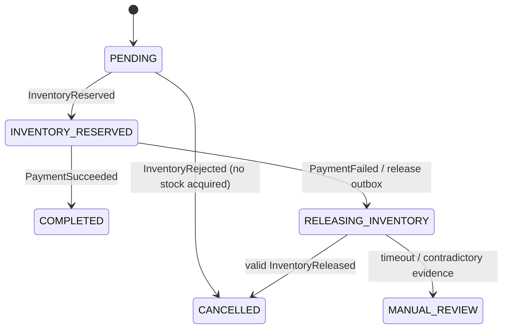

# ADR-0009: Orchestrated compensation and cancellation tombstones

**Status:** Implemented for Day 6; pending human review.

## State machine

Order Service is the only orchestrator. Its framework-free OrderSaga defines allowed
transitions; the persistence adapter validates causal evidence before invoking it.

PAYMENT_FAILED_PENDING_COMPENSATION remains a compatible enum and is recorded as the
intermediate history entry before RELEASING_INVENTORY in the same transaction. No HTTP
response can observe half that transition. INVENTORY_REJECTED remains readable for old
orders; new rejections cancel without requesting payment or release. Cancellation after
a failed payment requires a matching release confirmation. COMPLETED, CANCELLED and
MANUAL_REVIEW never automatically transition further. Late results are recorded as
ignored evidence; exact physical duplicates do not add history.

An approved COMPLETED order ignores delayed PaymentFailed and never writes a release
request. If a contradictory PaymentSucceeded arrives after compensation has begun,
the order enters MANUAL_REVIEW and unsent release publication is abandoned. A command
already dispatched cannot be recalled; this is an ambiguous protocol violation, not a
claim that concurrent contradictory or forged producer decisions can be undone. The
Payment Service's unique durable decision prevents this in the supported normal flow.

## Contracts, causal checks and service boundaries

Two new closed JSON v1 contracts retain the established envelope. InventoryReleaseRequested
is sent to flowops.inventory-release-requests.v1 with causationId = PaymentFailed event ID
and reservationEventId = original InventoryReserved ID. InventoryReleased is sent to
flowops.inventory.v1 with causationId = release request ID, the same reservationEventId,
and outcome RELEASED, ALREADY_RELEASED or ABSENT_PREVENTED. Keys are order UUIDs;
correlationId remains unchanged. Earlier v1 schemas are not modified.

Order validates each result against its own specific causal outbox row, aggregate and
correlation. Release confirmations must also echo the expected reservation event. The
release request, state, inbox, history and retry schedule commit together. Inventory
checks existing reservations/decisions against its own InventoryReserved outbox identity
and correlation. No cross-service database reads or shared persistence are introduced.
Causation to PaymentFailed is carried as orchestrator evidence: Inventory cannot verify
Payment's private database. Kafka producers are trusted in the existing local setup.

Inventory uses a separate release consumer group so an invalid OrderCreated cannot block
compensation in that consumer. PostgreSQL release changes, cancellation mark, inbox,
release decision and result outbox commit in one transaction. The relay cannot see the
result until commit. Unique aggregate/logical keys allow one release result alongside
one reservation decision, without limiting future unrelated events per aggregate.

## Missing reservations and serialization

V6 introduces reservation_guard keyed by order. Every reservation/release path, including
the standalone internal API, locks this durable row before reservation/decision and stock
rows. Concurrent first inserts use the PK; a loser rolls back and retries in a fresh
transaction. Stock locks retain deterministic product ordering. Existing reservations
are seeded into the guard table during migration.

A missing release now persists cancelled=true and returns Optional.empty from the internal
API. A later reserve for that order is explicitly rejected with ReservationCancelled;
OrderCreated emits the existing v1 RESERVATION_RELEASED rejection. No stock is modified.
There is no automatic tombstone reset. A fresh order ID is required for a new purchase.
An existing released reservation still replays as RELEASED for matching lines.

An early release message with no reservation/decision persists ABSENT_PREVENTED, a
cancellation tombstone and InventoryReleased atomically. If Order expected a confirmed
reservation, ABSENT_PREVENTED is inconsistent evidence and leads to MANUAL_REVIEW,
not automatic CANCELLED. An orphan release result with no causal Order request is rejected
without acknowledgement. This safely prevents later stock acquisition but does not
invent successful compensation for a missing orchestration record.

## Retry policy, errors and history

saga_history persists order creation, each transition, retry and ignored logical result,
with event IDs and timestamps. Existing orders get a MIGRATED_BASELINE record, not an
invented historical sequence. saga_compensation stores the original release event ID,
attempt count, next deadline, ACTIVE/CONFIRMED/MANUAL_REVIEW and last error. saga_error and
Inventory compensation_error retain diagnostic codes. Inventory records errors in a new
transaction after the failed stock transaction rolls back; if PostgreSQL itself is down,
Kafka retries and logs are the only available evidence until storage recovers.

The scheduler scans up to 100 due orders each second. Default timeout is 60 seconds,
configurable with flowops.saga.retry-seconds (positive). There are three confirmation
windows: the first request and two rescheduling rounds. Each timeout requeues the SAME
outbox row/ID/JSON, never a new logical release. A scanner locks the order and rechecks
its persisted deadline, so restarts/concurrent scanners cannot reset or double-increment
attempts. On the third expired window, state becomes MANUAL_REVIEW, a durable timeout
error is written and pending release publication is abandoned.

These are bounded orchestration windows, not a count of low-level Kafka send/consumer
attempts. Existing relay retries and listener backoff (one second, no silent discard)
remain at least once. In-flight records may still release stock after manual escalation;
a late confirmation is retained without leaving MANUAL_REVIEW. Operators must reconcile
payment, inventory and event evidence before an explicit future recovery action. There
is no automatic destructive repair, forced cancellation or manual-resolution endpoint.
Malformed events can still block their partition; DLT belongs to later work.

## Outbox ordering and rollout

The Day 5 per-aggregate publication sequence and earlier-pending guard remain in all
relays. Order excludes abandoned requests from both selection and predecessor checks.
Order and inventory gain pending-publication indexes for the evolved queries. The
Inventory guard now serializes reservation and release result creation for an aggregate.
Broker acknowledgement still precedes database marking; a crash can produce duplicates.
There is no exactly-once guarantee spanning PostgreSQL and Kafka, nor total topic ordering.

Only new V6 migrations modify the merged Day 5 database. Stop old writers/relays during
rollout: old Inventory binaries bypass the cancellation guard. No cancellation decision
is backfilled for releases that happened before V6 with no reservation; that historical
absence is unknowable. Old payment-failed orders are not automatically released; inspect
history and causal records before operational recovery. Retention of guards, decisions,
inboxes and outboxes is indefinite and must not be shortened independently.

## Validation

Shared H2/PostgreSQL suites exercise duplicate/concurrent release, reserve-versus-missing
release races, rollback of stock/tombstone/outbox, wrong correlation/causal references,
retry deadlines after handler recreation, terminal-state safety and contradictory results.
The same inventory contracts run under both default and restricted alternate schemas.
Kafka/PostgreSQL tests run all three packaged services and cover success, insufficient
stock without payment, compensated decline, duplicate/delayed messages, consumer/relay
process restarts, and an injected release-outbox failure followed by recovery.
